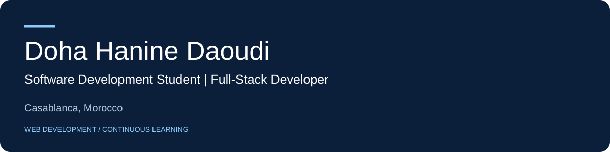

<b>Open to internships & professional opportunities · À la recherche de stages et d’opportunités professionnelles</b>

## About Me / À propos

**FR** — Étudiante en Licence Professionnelle en Développement Logiciel à l’Université Mundiapolis de Casablanca, je développe mes compétences en développement web Full-Stack à travers des projets concrets. Je souhaite contribuer à des projets innovants et poursuivre mes études en Master.

**EN** — I am a Software Development student at Mundiapolis University in Casablanca, building my Full-Stack web development skills through practical projects. I am looking to contribute to innovative projects and continue my studies at Master’s level.

## Tech Stack / Compétences

**Frontend**

    

**Backend**

  

**Databases / Bases de données**

 

**Tools / Outils**

   

**Learning / En apprentissage**

 

## Education / Formation

| Formation / Programme | Établissement / Institution |
| --- | --- |
| **En cours / Current** · Licence Professionnelle en Développement Logiciel / Professional Bachelor’s programme in Software Development | Université Mundiapolis, Casablanca |
| Diplôme de Technicien Spécialisé en Développement Digital / Specialized Technician Diploma in Digital Development | OFPPT |
| Formation qualifiante — Programme d’Innovation Entrepreneuriale (PIE) / Entrepreneurship Innovation Programme · **2026** | CMC ACEMC, Casablanca |

## Professional Goals / Objectifs professionnels

- **Développer / Build** — Approfondir mes compétences en développement logiciel et Full-Stack. / Deepen my software and Full-Stack development skills.
- **Contribuer / Contribute** — Participer à des projets innovants dans le cadre de stages et d’opportunités professionnelles. / Contribute to innovative projects through internships and professional opportunities.
- **Apprendre / Learn** — Explorer Flutter et Dart et préparer une poursuite d’études en Master. / Explore Flutter and Dart and prepare for Master’s studies.

## Contact / Me contacter

**FR** — Disponible pour échanger autour de stages, de projets Full-Stack et d’opportunités professionnelles.

**EN** — Open to conversations about internships, Full-Stack projects and professional opportunities.

[LinkedIn](https://www.linkedin.com/in/doha-hanine-daoudi-001a90385/) · [Email](mailto:dhaninedaoudi@gmail.com) · [GitHub](https://github.com/DHD-04)
